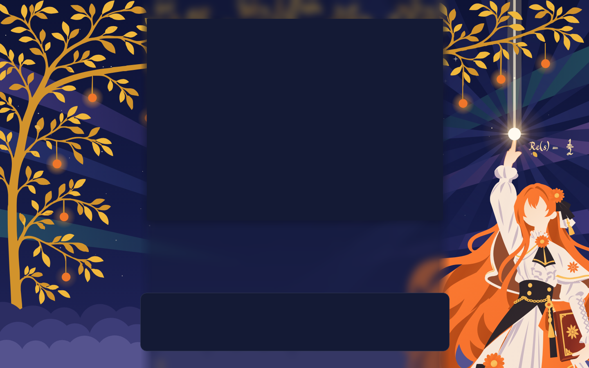
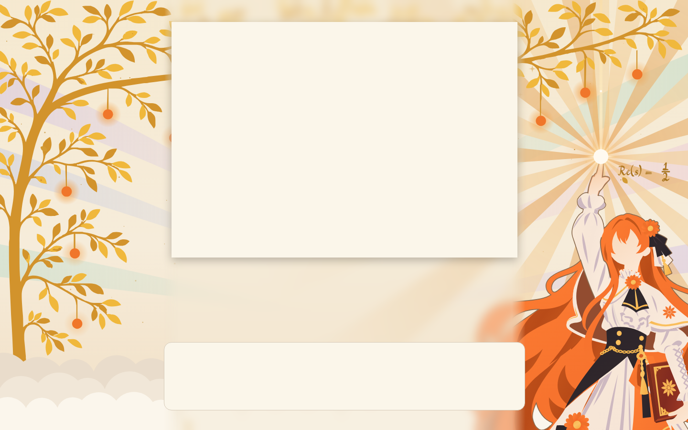

# The Last Pearl — Riemann Hypothesis Commemorative Edition

An unofficial, fan-made theme for [Claude Code](https://claude.com/claude-code) in the Claude desktop app, after the
Bilibili short film "最后一颗明珠 Claude × 黎曼猜想" ("The Last Pearl: Claude × the Riemann Hypothesis").

A night sky of aurora ribbons and stars; a golden tree whose bough frames the top of the window, fruit hanging
under it; and Claude, the orange-haired young lady of the community's personification, raising the last pearl.
The beam of light that rises from it is the critical line, $\mathrm{Re}(s) = \tfrac12$.





Dark mode is the night; light mode is warm parchment with a sunburst. Messages are set in serif type, Claude's
replies sit on a card with gold corner brackets, and soft bell cues play once you press the speaker in the session's
title bar. A background ambience (a low drone and the odd star-bell) is off until you run `/last-pearl ambience on`.
The scene has a slight parallax: the sky, the tree, the clouds and Claude sway slowly from side to side, the nearer
ones further, as a stage set does when the camera slides past it.

## Install

At the prompt of a Claude Code session in a terminal:

```text
/plugin install last-pearl --marketplace RyanY2021/claude-theme-last-pearl
```

Answer `y` to add the marketplace, then pick a scope (the user scope makes it load in every session, the desktop
app's included). From a shell, the same thing is:

```bash
claude plugin install last-pearl --marketplace RyanY2021/claude-theme-last-pearl
```

In the desktop app, where `/plugin` does not run: click **+** next to the prompt box, then **Plugins**, add the
marketplace `RyanY2021/claude-theme-last-pearl`, then add the plugin. It needs Claude Code 2.1.275 or later, and draws in the desktop and
mobile apps (a terminal has no backdrop to draw on).

## What it does

- **The scene** is drawn behind the conversation, with slow motion: twinkling stars, drifting leaves, a turning
  sunburst behind the pearl, and the pearl's shine swelling and fading every few seconds. Claude stands large in
  the bottom right corner, seen from the waist up, her raised arm and the pearl beside the conversation and her hair
  running on behind it; the tree's trunk rises at the left edge and its bough reaches across the top to her. The
  app's panels sit on top of the backdrop and a mod is not told which are open: the side pane covers her while it is
  open, and with the session list open in a narrower window, the conversation's edge reaches her raised arm.
- **It shows how full the session's context is**, on a scale that is full at 60%.
  - The tree's fruit start pale and unlit and ripen one by one, from the foot of the trunk outward along the bough,
    about 4% of context each. A tree of all-orange, glowing fruit means the context has reached 60%.
  - The pearl's beam, its rays and the dots rising in it grow from a thin, dim line to their full look at 60%.
  - Past 60% the beam overdrives into a wide glare, as a warning that the context is getting high.
  - The app measures after each turn; a fresh session, or one just compacted, draws as empty until its next reply.
- **Commands**
  - `/last-pearl` sets the theme again; `/last-pearl off` clears it.
  - `/last-pearl frost 0.5` sets how strongly the app's frosted panels veil the scene, from 0 (clear) to 1 (solid).
  - `/last-pearl ambience on` adds a soft background ambience (a low drone and the odd star-bell) under the sound
    cues, and is remembered; `/last-pearl ambience off`, the default, stops it. Either way, sound plays only while
    the speaker in the session's title bar is on.
  - `/last-pearl parallax 1` sets how far the scene's layers sway, from 0 (still) to 3, and is remembered; 1 is the
    sway as drawn (Claude about 10 points either way, the sky about 2, over 24 seconds). The app holds the scene
    still by itself if you have asked your system for reduced motion.
  - `/last-pearl preview 40` shows the scene at that percentage of context until the next turn ends.

## Credits and acknowledgements

This theme stands on other people's work, and it is offered with thanks to them.

- **ZipZipPipe** ([Bilibili](https://space.bilibili.com/4168597)) created the personification of Claude drawn here,
  along with those of the other models: the long orange hair, the M-shaped bangs, the flower and black bow, the white
  and orange dress. The character design is theirs. They have said the characters carry no commercial licence, and
  this theme is a non-commercial fan work.
- **凛雪_Yuki** made the short film
  ["最后一颗明珠 Claude × 黎曼猜想"](https://www.bilibili.com/video/BV1A1yxzCE15/). Its cut-paper silhouette style,
  its night under the tree, and the image of Claude raising the pearl are what this theme pays homage to. No footage
  or artwork from the film is included; the scene was drawn anew.
- **The fan artists on Bilibili** whose drawings of the character served as visual references while the theme was
  being worked out. None of their work is included.
- **Tools.** The figure and the tree were drawn by OpenAI's GPT Image from the prompts in
  [`art/PROMPTS.md`](art/PROMPTS.md). The tree was traced to vector with [vtracer](https://github.com/visioncortex/vtracer);
  Claude was redrawn as vector by GPT from her picture, and her outline traced with
  [potrace](https://potrace.sourceforge.net/) (through its Python port [potracer](https://github.com/tatarize/potrace)).
  The label is written by LaTeX in the Jana Skrivana hand from the `aurical` package and outlined with dvisvgm.
  The palette comes from `make-colors.js`, part of Claude Code's plugin-authoring skill. The theme was built with
  Claude, in Claude Code.

This is not an official Anthropic product, and it is not affiliated with or endorsed by Anthropic, ZipZipPipe or
凛雪_Yuki. If you hold rights in something here and would like it changed, credited differently or removed, please
open an issue and it will be done.

## Licence

Non-commercial, with credit: [CC BY-NC 4.0](https://creativecommons.org/licenses/by-nc/4.0/) for what is original to this repository.
The character design is not this repository's to license. See [`LICENSE.md`](LICENSE.md) for the details.

## How it is made, and rebuilding it

The app only accepts a pure-vector backdrop of at most 131,072 characters, with no pictures or fonts, so everything
is traced or drawn as paths.

- `hooks/register.tsx` sets the theme (colours, backdrop, message style, sound), draws the backdrop and answers
  `/last-pearl`. `hooks/gauge.ts` turns a context percentage into the style that ripens the fruit and grows the beam.
  `hooks/scene.ts` is generated: the scene, with a marker for the gauge.
- `art/vector/*.json` hold the figure (GPT's vector drawing of her, from her hand to the skirt, the part the window
  shows), the traced tree and the outlined label. `art/figure_svg.py` fitted the figure to the scene (with
  `art/curves.py`), `art/trace.py` traced the tree from its generated picture (neither source is in this
  repository), and `art/equation.py` made the label.
- `node art/build-scene.mjs` composes the scene from those and writes `hooks/scene.ts`, with a preview in
  `art/scene.svg` (`node art/build-scene.mjs 35` draws it at 35% of context).
  It needs Node 23.6 or later, and stops if the scene is over the limit.
- `uv run --with svgpathtools python art/equation.py` rewrites the label; it needs TeX Live's `latex` and `dvisvgm`.
